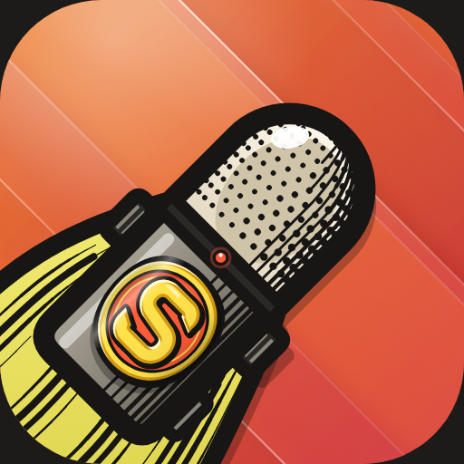

# The Super Voice icon

One design, drawn once as layers, from which every platform's files and every animation are made.

## Where things are

| Path | What it is |
|---|---|
| `layers/` (this folder) | The source artwork: eight layer SVGs on a 512 × 512 rounded square (corner radius 112). `cape/` and `shadow/` hold 24 animation frames each. |
| `animation.json` | The single source of truth for the layer order, canvas and motion. Read it; don't copy numbers out of this page. |
| `player.html` | A reference player that plays `animation.json` exactly. |
| `preview.png` | The still icon (the rest frame) at 512 px. |
| `reference/` | The research behind all of it, with sources (see the reference list at the end). |
| `brand/icon/master/super-voice-icon.svg` | The layers flattened into one SVG. Every platform is built from it. |
| `brand/icon/macos/`, `linux/`, `windows/` | Each platform's generated files and its build script. |
| `brand/icon/build.sh` | Rebuilds the master and every platform, then copies the Linux set into the app. |

## The design

- **Subject.** A desk USB microphone (mesh dome, dark seam with a red LED, solid housing, the gain knob and side knobs) wearing an olive cape, flying up and to the right at 45° through two orange-to-coral glass bands. Drawn as an engraving: thick black ink, hatching and halftone dots.
- **The S.** An original "Voice crest" S emblem in the pop roundel style (yellow S on coral, black keylines), wrapped onto the housing below the seam, at the body's angle. It must never imitate an existing superhero emblem: no five-sided diamond shield and no swooping hooked S (DC enforces its S-shield trademark). See `reference/emblem.md`.
- **Colour.** The tile is orange-to-coral; the cape is olive. The olive/lime family is one no Apple system icon uses, which is part of why it stands out in a Dock.
- **One small icon everywhere.** Below about 32 px the full artwork turns to mud, so every one-colour small icon is the same glyph: the macOS menu-bar template, the Linux symbolic panel icon and the Windows tray icons. It is the caped desk mic at 45° with the S roundel cut out, drawn by `menubar_svg` in `brand/icon/macos/tools/build.py`. Change it there and all three follow.

## Generating the icon files

Run `brand/icon/build.sh` after any change to the layers. It needs Python 3 with Pillow, shapely and scour, `rsvg-convert` (librsvg), and Node with Playwright and Chromium. It runs these, in this order:

1. `brand/icon/master/build.py` flattens the layers into the master SVG.
2. `brand/icon/macos/tools/build.py` builds the macOS files.
3. `brand/icon/linux/build.py` builds the Linux files.
4. `brand/icon/windows/src/build.py` builds the Windows files.

The script then copies the Linux theme into `super-voice-gpui/resources/icons/hicolor/`. Rebuilds are reproducible: unchanged layers give byte-identical icons, apart from rounding noise of one step out of 255 in a few macOS preview images and the PDF's timestamp. Don't commit noise-only changes.

### macOS (`brand/icon/macos/`, research in `reference/macos.md`)

- **`AppIcon.icns`:** 16–1024 at @1x and @2x, on Apple's 1024 grid. The tile is 824 px with continuous corners of radius 185.4 and a 100 px transparent margin. It is opaque, with no baked drop shadow, because macOS 26 puts icons with a soft edge into a grey tile. The 16 and 32 px sizes use simplified art. The bundle's `macos-icon` recipe in `justfile` copies this file in, and `Info.plist` keeps `CFBundleIconFile = AppIcon`.
- **`AppIcon.icon`:** an Icon Composer package for macOS 26 Liquid Glass. Apple doesn't publish the format, so check it in Icon Composer on a Mac. Using it needs Xcode 26's `actool` and `CFBundleIconName`.
- **`variants/`:** dark (an ember-brown ground) and tinted (greyscale).
- **`menubar/`:** the template glyph (black and alpha, `isTemplate = true`) at 16, 18 and 22 pt, with @2x.
- **Still needs a Mac:** check that the icon shows without the grey tile, that the corner curve matches Apple's template, and that the `.icon` package imports.

### Linux (`brand/icon/linux/`, research in `reference/linux.md`)

- **hicolor theme:** a scalable SVG, PNGs at 16, 22, 24, 32, 48, 64, 128, 256 and 512, and `symbolic/apps/super-voice-app-symbolic.svg`.
- **Safe area:** following GNOME and Flathub, the tile sits at 416/512 with a transparent margin. At 16–32 px the margin is only 1–2 px.
- **librsvg compatibility:** the scalable SVG has no nested `<svg>` elements, it expands `feDropShadow` into basic filter steps, and it uses `xlink:href`, so older librsvg draws it.
- **Symbolic icon:** this is the shared small icon, cut for 2x and recoloured with `currentColor` and KDE's `ColorScheme-Text` class.
- **Installing:** `just install-app` installs every size and runs `gtk-update-icon-cache`, and `uninstall.sh` removes them. The release installer lives in the super-engine repo; until `super-engine-installer-icons.patch` is applied there, it installs only the SVG.
- **Names:** the desktop entry and icon are named `super-voice-app`, and the metainfo and Wayland app ID are `org.superlibre.SuperVoice`. Flathub would need both renamed to the ID.

### Windows (`brand/icon/windows/`, research in `reference/windows.md`)

- **`super-voice.ico`:** 14 frames (16, 20, 24, 30, 32, 36, 40, 48, 60, 64, 72, 80, 96 and 256), 32-bit BMP below 256 and PNG at 256. Frames from 16 to 32 px use the simplified colour glyph from `src/glyphs.py`, built from these layers.
- **`msix/Assets/`:** every logo and tile at every scale, including the `altform-unplated` targetsize icons. It still needs `makepri` to build `resources.pri`.
- **`tray/`:** the shared small icon at 16, 20, 24 and 32 px, in white for dark taskbars and `#1c1c1c` for light ones. Pick by `SystemUsesLightTheme`.
- **No Windows build yet.** `reference/windows.md` has the `build.rs`, `.rc` and `AppxManifest` snippets to wire it in.

### Checking a change

- **Look at the preview sheets.** Each platform build writes a `preview.png`. Read them; don't assume.
- **Score it with `reference/review-rubric.md`.** That means recognition at 32 px, silhouette, a 3 px blur test, a 16 px greyscale test, contrast and distinctiveness in a Dock of real icons.
- **Compare small sizes with the master.** Any simplified small size must read as the same object as the master. Blur the two side by side; if they look like different objects, the small one is wrong.

## Animating the icon

The layers, back to front:

| # | Layer | Motion |
|---|---|---|
| 0 | `ground` | none |
| 1 | `band-far` | scrolls, slow |
| 2 | `band-near` | scrolls, faster |
| 3 | `light` | none |
| 4 | `shadow` | 24 frames, locked to the cape |
| 5 | `cape` | 24 frames |
| 6 | `mic` | none |
| 7 | `emblem` | none |

The ink layers (shadow, cape, mic, emblem) are already drawn at the 45° flight heading, with a baked `rotate(5 238 290)`. Place every layer at its `viewBox` at full size.

### Motion rules

Keep these when adding states or porting the animation:

1. **Depth comes from relative speed.** The ground never moves. Layers above it move more the closer they are to the mic.
2. **Things stream past opposite the flight.** The bands scroll along `(-0.7071, 0.7071)`, toward the lower left, straight behind the mic. Never scroll along a band's length; that reads as a barber pole (`reference/motion-loops.md`).
3. **Scrolling is seamless and linear.** Each band repeats every `period` units on an oversized `-512 -512 1536 1536` canvas. Translate it by exactly one period over `duration_ms`, linearly, forever. Eased loops stutter.
4. **The bands repeat at different periods** (340 and 400), so they never fall into one visible repeat.
5. **The cape is the fastest thing on screen.** It plays 24 frames at 20 fps, one billow every 1.2 s; the bands take 4–5 s per period. Speed order: cape, then near band, then far band.
6. **The shadow frames are locked to the cape frames.** Drive both from one clock.
7. **The ink group moves as one.** The mic, emblem, cape and shadow never move relative to each other.
8. **The rest frame is the icon.** That is frame 0 of every layer with no scroll offset. Start from it, and stop on it.
9. **Respect reduced motion.** Show the rest frame.

### Playing it

Scale everything by `size / 512` and clip the stack to the rounded square.

- **`static`:** draw it once.
- **`scroll`:** translate by `direction × period` over `duration_ms`, linear and infinite.
- **`frames`:** show frame `floor(elapsed_s × fps) mod frame_count`. Preload every frame.

`player.html` does exactly this. To view it, serve this folder (`python3 -m http.server -d .claude/skills/super-voice-icon 8000`) and open `player.html`. Add `?size=64` for a small size, or `?still` for the rest frame.

### Where it can animate

Be precise about what each platform allows (`reference/apple-layered-icons.md`).

- **macOS Dock.** The system icon never animates: macOS 26 draws the layered icon as one still glass object, and nothing moves on hover, click or launch. Only tvOS shifts icon layers, and only iPhone moves light with the gyroscope. The running app can animate its own Dock tile:
  - give `NSDockTile` a custom `contentView` that draws the stack, and call `display()` each tick;
  - pre-render the frames and the bands at tile size, then composite them;
  - play it while listening or speaking, and return to the rest frame when idle.
- **The app (GPUI, `super-voice-gpui/`, on Linux and macOS).** It draws the still icon today: `src/assets.rs` serves the scalable hicolor SVG as `APP_ICON`, for the sidebar header, the About page and the title bar. To animate it, stack the layers clipped to the rounded square (radius `size * 112 / 512`), drive the offsets and frame index from one clock, redraw only while visible, and respect reduced motion.
- **Web, README and video.** Use `player.html`, or export a loop (below). GitHub READMEs don't run scripts, so use a GIF, APNG or WebP there.
- **Linux app icon, installer and tray.** These are static. Use the platform files above.

**Exporting a loop.** The full cycle that returns exactly to the start is 312 s (the least common multiple of 1.2, 4.0 and 5.2). For a short export, render 4.0 s at 20 fps: the cape and the near band loop perfectly in that time. Either accept a small jump in the far band, or use an export-only copy of `band-far` with `duration_ms` 4000.

## Changing the artwork

1. **Edit the layers in `layers/`.**
   - Keep every layer in the same 512 frame.
   - Keep the ink group at the 45° heading.
   - Keep every band periodic: it must look identical after a shift of exactly one `period`. Prove that by rendering both and comparing the pixels.
   - Keep 24 even cape frames that loop, each with a matching shadow frame.
2. **Update `animation.json`** if the timing, order or files change.
3. **Run `brand/icon/build.sh`.**
4. **Check the previews and the rubric** (see Checking a change).
5. **Replace `preview.png`** in this folder with the new rest frame.
6. **For the system macOS icon,** Icon Composer takes at most four groups of flat, unclipped layers: ground, bands, the ink group, then the emblem. It adds the glass, highlights and shadows itself.

## Reference

| File | Contents |
|---|---|
| `reference/macos.md` | macOS 26 icon rules, the `.icns` and Icon Composer formats, the menu-bar template, sources. |
| `reference/linux.md` | freedesktop/hicolor, the GNOME, COSMIC and KDE guidance, Flathub and AppStream, librsvg limits, sources. |
| `reference/windows.md` | The `.ico` sizes, the MSIX asset table, tray guidance, wiring snippets, sources. |
| `reference/apple-layered-icons.md` | How Apple platforms treat layered icons, and what moves on each. |
| `reference/motion-loops.md` | Speed lines, parallax and seamless loops, and why the bands scroll the way they do. |
| `reference/emblem.md`, `images/emblem*.png` | The S emblem's design, sizing, wrap recipe, and what to avoid legally. |
| `reference/desk-mic.md`, `images/desk-mic.png` | The desk microphone's anatomy and proportions. |
| `reference/review-rubric.md` | How to score an icon change. |
