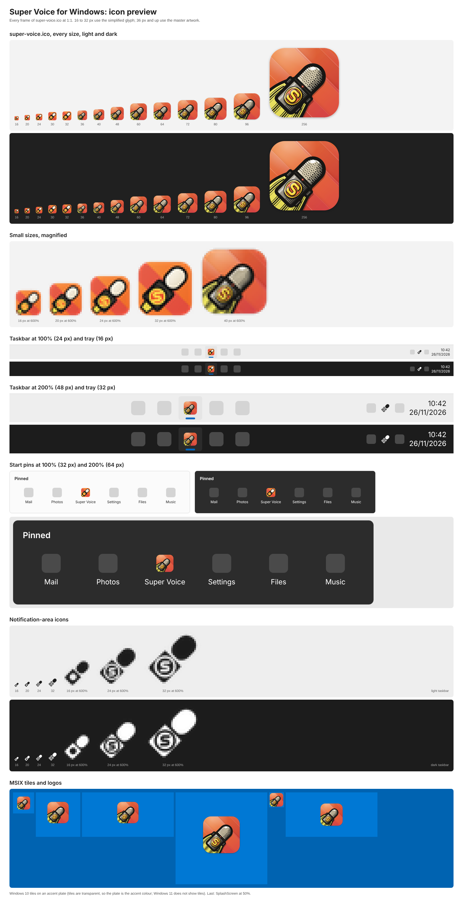

# Super Voice for Windows: app icon

These are the Windows icon assets for Super Voice, made from the master icon (`brand/icon/master/super-voice-icon.svg`: the caped desk microphone flying through orange-to-coral glass bands, with the pop roundel S).

**Status: Super Voice has no Windows build yet.** No crate has `cfg(windows)` code, and nothing uses `winres`, `winresource` or `embed-resource`. The repo has no `.rc` files, no MSIX, WiX or Inno installer, and no Windows target in `.github/workflows/release.yml`, which builds Linux only. So nothing here is wired in. The assets are ready to use, and [Wiring](#wiring-once-a-windows-build-exists) has the exact snippets for when a Windows build exists.



## Files

| Path | What it is | Where it's used |
|---|---|---|
| `super-voice.ico` | App icon with 14 frames: 16, 20, 24, 30, 32, 36, 40, 48, 60, 64, 72, 80, 96 and 256. The frames below 256 are 32-bit BMP (DIB) with an AND mask; the 256 frame is PNG. The 32 frame comes first in the file. | Embedded in each `.exe` as resource `1 ICON` (Explorer, title bar, Alt+Tab, taskbar and Start for unpackaged apps). Also the window icon at runtime, and the installer and uninstaller icon. |
| `png/super-voice-<N>.png` | Each ICO frame as a PNG, byte-identical in pixels. | For tools that want PNGs (`tauri icon`-style sets, WiX or Inno bitmaps, `winit`/`tao` window icons, `ico` crate). |
| `msix/Assets/Square44x44Logo.targetsize-<N>.png` | App-list icon at exact sizes: 16, 20, 24, 30, 32, 36, 40, 48, 60, 64, 72, 80, 96 and 256. | MSIX: taskbar, Start, search, all-apps list, Explorer for packaged apps. |
| `msix/Assets/Square44x44Logo.targetsize-<N>_altform-unplated.png` | The same, for the dark theme. Required. | Without it, Windows draws the icon smaller, on a coloured backplate. |
| `msix/Assets/Square44x44Logo.targetsize-<N>_altform-lightunplated.png` | The same, for the light theme. Required. | As above, in the light theme. |
| `msix/Assets/Square44x44Logo.scale-{100,125,150,200,400}.png` | 44, 55, 66, 88 and 176 px. | The manifest's `Square44x44Logo`, the fallback when no targetsize asset matches. |
| `msix/Assets/SmallTile.scale-*.png` | 71, 89, 107, 142 and 284 px. The icon fills 62% of the tile. | `Square71x71Logo` (Windows 10 small tile). |
| `msix/Assets/Square150x150Logo.scale-*.png` | 150 to 600 px. The icon is 48% of the tile, lifted 5% to clear the tile's name label. | Windows 10 medium tile. **Required for the Store.** |
| `msix/Assets/Wide310x150Logo.scale-*.png` | 310×150 to 1240×600 px. | Windows 10 wide tile. |
| `msix/Assets/LargeTile.scale-*.png` | 310 to 1240 px. The icon is 40% of the tile. | `Square310x310Logo` (Windows 10 large tile). Needs the wide tile as well. |
| `msix/Assets/StoreLogo.scale-*.png` | 50, 63, 75, 100 and 200 px. | Package logo (Store, installer UI). **Required for the Store.** |
| `msix/Assets/SplashScreen.scale-*.png` | 620×300 to 2480×1200 px. The icon is 50% of the height, on a transparent background. | `uap:SplashScreen`. Only UWP-style activation shows it; a Win32 full-trust app such as ours usually never does. |
| `tray/super-voice-tray-dark-taskbar.ico` and `tray/tray-dark-taskbar-<N>.png` | White one-colour glyph, 16, 20, 24 and 32 px. | Notification area when the taskbar is dark. |
| `tray/super-voice-tray-light-taskbar.ico` and `tray/tray-light-taskbar-<N>.png` | Near-black (`#1c1c1c`) one-colour glyph, the same sizes. | Notification area when the taskbar is light. |
| `preview.png` | Contact sheet: every ICO frame on light and dark, small sizes magnified, mock taskbars at 100% and 200%, Start pins at 100% and 200%, tray icons, and the MSIX tiles. | Review only. |
| `src/small.svg` | The simplified colour icon used at 16–32 px. | Source. |
| `src/tray.svg` | The one-colour tray glyph (`currentColor`). | Source. |
| `src/build.py`, `src/render.js`, `src/preview.py` | The generator. `python3 brand/icon/windows/src/build.py` rebuilds everything here. | Rebuild after changing the master or the sources. |

The other `targetsize` sizes come from the same list Windows 11 uses for the app list (Microsoft's *App icon construction* page). The plated `targetsize-N.png` files and the unplated ones are the same pixels: the icon carries its own tile, so it needs no plate. Microsoft still requires all three files: "Separate files for all three theme variations … are required, even if the icon is the same."

## Design decisions

### Shape: keep the rounded square, inside transparent padding

Windows does not mask app icons. There is no forced squircle like on iOS or macOS 26: what you ship is what draws. Microsoft says "icons look best with a transparent background," and its own Fluent icons are free-standing silhouettes on a 48×48 grid. A plated icon is "okay too," but then you have to handle theming yourself.

I kept the rounded-square tile for these reasons:

- The artwork is full-bleed by design. The glass bands and the cape run off the tile edge, and the mic head is cropped by it. Cutting the mic out as a free silhouette would drop the bands and the orange ground that carry the brand, and the result would be a different icon.
- One asset covers default, unplated and lightunplated, with no theme-specific art. On contrast: the tile's mid orange (`#ee6c24`) is about 5.3:1 on the dark taskbar (`#202020`), but only about 2.8:1 on the light one (`#f3f3f3`), just under Microsoft's 3:1. On light, the black ink, the dark mic body and the soft key shadow carry the edge. If light-theme contrast needs to pass on the tile alone, the fix is a light-theme variant with a slightly darker rim, shipped as the `_altform-lightunplated` files.
- It matches the macOS and Linux icons, so the app is recognisable across platforms.

To sit like a Windows icon rather than a pasted app-store tile, the tile is **inset in a transparent canvas**: `pad = max(1, round(N/24))` px per side (1 px at 16–32, 2 px at 36–48, 3 at 60–72, 4 at 96, and 11 at 256). The rest of the frame is transparent. Nothing in Windows adds a plate behind it, because the unplated targetsize assets are present.

The corner radius stays the brand's 112/512 (21.9%). Microsoft's "2 px radius at 48×48" is for the corners of shapes inside a Fluent icon, not a required outline. If a squarer Windows look is wanted later, change the `rx` in the master clip and `src/small.svg` and rebuild.

### Drop shadow

Microsoft asks for shadows to separate layers, with a light source from the top left, and its own Windows 11 icons carry a soft, short key shadow. The master already has an inked shadow inside. At 40 px and up I add only a small outer shadow below the tile: offset 1.2% of the tile size, blur 1.6%, black at 30%, which fits in the padding. Below 40 px there is no shadow, because it would only blur the edge.

### Small sizes: a simplified glyph at 16–32 px

At 16–32 px the master turns to mud: the halftone grille, the cape's hatching and the S's outline all go below a pixel. `src/small.svg` redraws the same scene with fewer, bolder shapes on a 32-unit grid:

- the same orange tile and radius, with one coral band at the 45° flight heading
- the mic as two shapes: a cream capsule head and a dark body, each with a 1.5-unit black ink outline
- a short olive-yellow cape wedge
- the S roundel: a yellow ring with an ink outline, a red disc, and a yellow S

The S is **upright** here, where the master's S is tilted onto the body. At 6–11 px an upright S is the only one that reads.

From 36 px up the frames use the master artwork. At 16 and 20 px the roundel reads as a yellow badge on the mic rather than as a legible S, which is the expected floor. The mic silhouette and the badge still read (see the magnified row in `preview.png`).

These are high-quality vector renders (4× supersampled, then Lanczos in premultiplied alpha). They are not hand-placed pixels. If a pixel-perfect 16 px is ever needed, hand-edit `png/super-voice-16.png` and repack the ICO.

### Tray icons: one colour, light and dark

Windows 11's own notification-area icons are one-colour glyphs that follow the taskbar theme, and full-colour art at 16 px gets lost there. The icon-animation skill already says the tray "needs a separate one-colour symbol". `src/tray.svg` is the flying mic as a solid silhouette:

- At 24 and 32 px, the roundel is set into the body as a gap ring, with the S cut out of the disc.
- At 16 and 20 px, there are too few pixels for that. The roundel becomes a single round hole in the body, which stays crisp.

Ship both colours and pick by the **taskbar** theme, not the app theme. Read `HKCU\Software\Microsoft\Windows\CurrentVersion\Themes\Personalize\SystemUsesLightTheme` (1 = light taskbar) and switch on `WM_SETTINGCHANGE` with `"ImmersiveColorSet"`. Users can set a dark taskbar with light apps, and tray icons picked by the app theme then disappear (see the Pritunl and KDE reports below). Microsoft asks for a 16×16 and a 32×32 in the resource and loading with `LoadIconMetric`, so the tray `.ico` files hold 16, 20, 24 and 32.

### ICO encoding

- **Sizes.** The Windows 11 scale table is:

  | Where | 100% | 125% | 150% | 200% | 250% | 300% | 400% |
  |---|---|---|---|---|---|---|---|
  | Context menu, title bar, tray | 16 | 20 | 24 | 32 | 40 | 48 | 64 |
  | Taskbar, search, Start all apps | 24 | 30 | 36 | 48 | 60 | 72 | 96 |
  | Start pins | 32 | 40 | 48 | 64 | 80 | 96 | 256 |

  Windows looks for an exact match first, then scales down from the next larger size. So the ICO holds every size in that table: 16, 20, 24, 30, 32, 36, 40, 48, 60, 64, 72, 80, 96 and 256. Microsoft's minimum is 16, 24, 32, 48 and 256. Explorer's large and extra-large views and Alt+Tab use the 48–256 frames.
- **PNG at 256, BMP below.** Microsoft recommends storing 32-bit 256×256 icons as PNG to keep the file small; Vista and later read PNG frames. The smaller frames are 32-bit BGRA DIBs with a 1-bit AND mask, the most compatible form for every loader and resource compiler (old `windres`, GDI `LoadImage`, third-party tools). The file is 232 KB. Converting the 48–96 frames to PNG would halve that if size ever matters.
- **Frame order.** The 32 px frame comes first, as Tauri recommends: some tools and dev runs show the first frame.
- **Colour depth.** All frames are 32-bit, which gives 8-bit alpha. There are no 8-bit or 4-bit palette frames: Windows 11 never asks for them.

## Wiring (once a Windows build exists)

The crates whose `.exe` users see are `super-voice-app`, which carries the icon, plus `super-voice-consent` and `super-voice-daemon`, which should carry it too so Explorer and Task Manager show it. `super-voice-cli` is optional.

### Option A: `winresource` (simplest)

Add to `super-voice-app/Cargo.toml`:

```toml
[target.'cfg(windows)'.build-dependencies]
winresource = "0.1"
```

Then add to `super-voice-app/build.rs`, inside `main()` before `Ok(())`:

```rust
// Embed the Windows app icon. Check the *target* OS: build.rs runs on the host.
if std::env::var("CARGO_CFG_TARGET_OS").as_deref() == Ok("windows") {
    println!("cargo:rerun-if-changed=../brand/icon/windows/super-voice.ico");
    let mut res = winresource::WindowsResource::new();
    res.set_icon("../brand/icon/windows/super-voice.ico") // becomes resource ID 1
        .set("ProductName", "Super Voice")
        .set("FileDescription", "Super Voice");
    res.compile()?;
}
```

`winres` itself is unmaintained and broken on Rust 1.61 and later; use `winresource` (or `tauri-winres`). Building with the MSVC target needs the Windows SDK's `rc.exe`; the GNU target needs MinGW's `windres` and `ar`.

### Option B: `embed-resource` with a `.rc` file

Add `super-voice-app/windows/super-voice.rc`:

```rc
// Resource ID 1 is the icon Explorer and the taskbar show for the .exe.
1 ICON "../../brand/icon/windows/super-voice.ico"
// The tray icons, loaded at runtime with LoadIconMetric(hinst, MAKEINTRESOURCE(id), LIM_SMALL, &hicon)
101 ICON "../../brand/icon/windows/tray/super-voice-tray-dark-taskbar.ico"
102 ICON "../../brand/icon/windows/tray/super-voice-tray-light-taskbar.ico"
```

Add the dependency:

```toml
[target.'cfg(windows)'.build-dependencies]
embed-resource = "3"
```

And in `build.rs`:

```rust
if std::env::var("CARGO_CFG_TARGET_OS").as_deref() == Ok("windows") {
    println!("cargo:rerun-if-changed=windows/super-voice.rc");
    embed_resource::compile("windows/super-voice.rc", embed_resource::NONE)
        .manifest_optional()
        .unwrap();
}
```

`rc.exe` resolves paths relative to the `.rc` file.

### Runtime window icon

The embedded icon covers Explorer, the taskbar and Alt+Tab, because Windows uses the exe's first icon group for the window class. For an explicit winit or iced window icon, load `png/super-voice-32.png` (and 256) with `winit::window::Icon::from_rgba` instead.

### Tray

With the `tray-icon` crate:

```rust
let light = taskbar_is_light(); // SystemUsesLightTheme == 1
let ico = if light { "super-voice-tray-light-taskbar.ico" } else { "super-voice-tray-dark-taskbar.ico" };
let icon = tray_icon::Icon::from_path(ico, Some((16, 16)))?; // or from_resource(101/102, ..)
```

Re-select the icon on `WM_SETTINGCHANGE` when `lParam` is `"ImmersiveColorSet"`.

### MSIX / AppX manifest excerpt

Copy `msix/Assets/` into the package root as `Assets\`, then in `AppxManifest.xml`:

```xml
<Package ...
  xmlns:uap="http://schemas.microsoft.com/appx/manifest/uap/windows10"
  xmlns:rescap="http://schemas.microsoft.com/appx/manifest/foundation/windows10/restrictedcapabilities">
  <Properties>
    <DisplayName>Super Voice</DisplayName>
    <PublisherDisplayName>Super Voice contributors</PublisherDisplayName>
    <Logo>Assets\StoreLogo.png</Logo>
  </Properties>
  <Applications>
    <Application Id="SuperVoice" Executable="super-voice-app.exe" EntryPoint="Windows.FullTrustApplication">
      <uap:VisualElements
          DisplayName="Super Voice"
          Description="Speech to text and text to speech"
          BackgroundColor="transparent"
          Square150x150Logo="Assets\Square150x150Logo.png"
          Square44x44Logo="Assets\Square44x44Logo.png">
        <uap:DefaultTile
            Wide310x150Logo="Assets\Wide310x150Logo.png"
            Square71x71Logo="Assets\SmallTile.png"
            Square310x310Logo="Assets\LargeTile.png"
            ShortName="Super Voice">
          <uap:ShowNameOnTiles>
            <uap:ShowOn Tile="square150x150Logo"/>
            <uap:ShowOn Tile="wide310x150Logo"/>
            <uap:ShowOn Tile="square310x310Logo"/>
          </uap:ShowNameOnTiles>
        </uap:DefaultTile>
        <uap:SplashScreen Image="Assets\SplashScreen.png" BackgroundColor="#ee6c24"/>
      </uap:VisualElements>
    </Application>
  </Applications>
</Package>
```

The manifest names the base file (`Square44x44Logo.png`). MRT resolves the `.scale-*`, `.targetsize-*` and `_altform-*` qualifiers from the files on disk. Build the `resources.pri` with `makepri` (the MSIX Packaging Tool and `makeappx` with a priconfig do it), or the unplated assets are ignored and the icon gets a backplate. `BackgroundColor="transparent"` makes Windows 10 tiles use the accent colour behind our self-plated icon.

## Research sources

- Microsoft Learn, *Design guidelines for Windows app icons*: metaphor, typography, the grid, the 2 px corner radius at 48, gradients, 3:1 contrast on light and dark, layering and shadow, optional light and dark assets. https://learn.microsoft.com/en-us/windows/apps/design/iconography/app-icon-design
- Microsoft Learn, *Construct your Windows app's icon*: the scale-factor size table, the exact-match-then-scale-down rule, the 16/24/32/48/256 minimum, manifest base sizes at each scale, the required targetsize, unplated and lightunplated file lists, "icons look best with a transparent background", the backplate note, tiles unused on Windows 11 but the 100% medium tile required for the Store, StoreLogo required. https://learn.microsoft.com/en-us/windows/apps/design/iconography/app-icon-construction
- Microsoft Learn, *uap:SplashScreen* schema: 620×300 base. https://learn.microsoft.com/en-us/uwp/schemas/appxpackage/uapmanifestschema/element-uap-splashscreen
- Microsoft Learn, *uap:VisualElements* schema. https://learn.microsoft.com/en-us/uwp/schemas/appxpackage/uapmanifestschema/element-uap-visualelements
- Microsoft Q&A, *Tiny taskbar icons in Windows 11*: adding `targetsize-24_altform-unplated` removed the plate. https://learn.microsoft.com/en-us/answers/questions/668259/tiny-taskbar-icons-in-windows-11
- Microsoft Tech Community, *Windows 10 and 11 package icons resources*: unplated naming, and the need for `resources.pri`. https://techcommunity.microsoft.com/discussions/msix-discussions/windows-10-and-11-package-icons-resources/3006275
- Krita's MSIX assets, a real-world naming example (`Square44x44Logo.altform-unplated_targetsize-16.png`). https://lxr.kde.org/source/graphics/krita/packaging/windows/msix/pkg/Assets/
- Wikipedia, *ICO (file format)*: PNG frames since Vista, Microsoft recommends PNG for 256×256, BMP for compatibility. https://en.wikipedia.org/wiki/ICO_(file_format)
- Raymond Chen, *The Old New Thing* on ICO formats. https://devblogs.microsoft.com/oldnewthing/20231025-00/?p=108925
- Microsoft Learn, *Notification area*: ship 16×16 and 32×32 and use `LoadIconMetric`; tray icons should be high-DPI aware. https://learn.microsoft.com/en-us/windows/win32/shell/notification-area
- Microsoft Learn, *LoadIconMetric*. https://learn.microsoft.com/en-us/windows/win32/api/commctrl/nf-commctrl-loadiconmetric
- Pritunl forum, a tray icon invisible with a dark taskbar and light apps: pick the tray colour by the taskbar theme. https://forum.pritunl.com/t/bug-pritunl-windows-clients-system-tray-icon-color-is-broken-dark-icon-under-light-app-mode/2915
- KDE bug 453094, a tray icon invisible on a dark Windows theme. https://bugs.kde.org/show_bug.cgi?id=453094
- ElevenForum, `SystemUsesLightTheme` and `AppsUseLightTheme`. https://www.elevenforum.com/t/change-to-dark-or-light-color-mode-in-windows-11.555/
- `winresource` README: `set_icon`, checking `CARGO_CFG_TARGET_OS`, and `winres` broken on Rust 1.61 and later. https://docs.rs/crate/winresource/latest
- `tauri-winres`, the fork built on `embed-resource`. https://docs.rs/crate/tauri-winres/0.3.5/source/README.md
- `embed-resource` docs: `compile(..., NONE)` and `.manifest_optional()`. https://docs.rs/embed-resource
- `windres` crate docs: `1 ICON "file.ico"` `.rc` syntax. https://docs.rs/crate/windres/latest
- Tauri, *App icons*: ICO frames 16/24/32/48/64/256 with 32 first, and the Square*Logo/StoreLogo set. https://v1.tauri.app/v1/guides/features/icons and https://v2.tauri.app/develop/icons/
- CodeProject, *What icon sizes are used by Windows*. https://www.codeproject.com/Articles/1067619/What-Icon-Sizes-Are-Used-by-Windows
- Visual Studio image guidelines: use 15×15 or less of a 16 px frame for glyphs. https://learn.microsoft.com/en-us/visualstudio/extensibility/ux-guidelines/images-and-icons-for-visual-studio

## Caveats

- **Not tested on Windows.** The renders and the ICO structure are verified (below), but nothing has been seen on a real taskbar, and there is no packaged MSIX to test `resources.pri` resolution.
- **The 16 and 20 px app icon is a recognisable mic with a yellow badge, not a readable S.** That is the floor at 16 px.
- **The splash screen** is generated for completeness. A full-trust Win32 app does not normally show it.
- **The Windows 10 light-theme tile variants** (`_altform-colorful_theme-light`) are omitted. They are optional, and the art would be identical.
- **No high-contrast assets.** Windows 11 no longer requires them.

## Verification

- `super-voice.ico` read back with Pillow. It lists 14 sizes (16 to 256), and every frame decodes pixel-identical to `png/super-voice-<N>.png`. The ICO directory shows 13 BMP (32 bpp) entries and one PNG entry (256). `file` and ImageMagick `identify` also read all 14 frames.
- The tray `.ico` files have 4 BMP entries each (16, 20, 24, 32).
- Every MSIX asset's pixel size was checked against Microsoft's table, rounding half up: 50 px at 125% is 63, and 71 px at 150% is 107.
